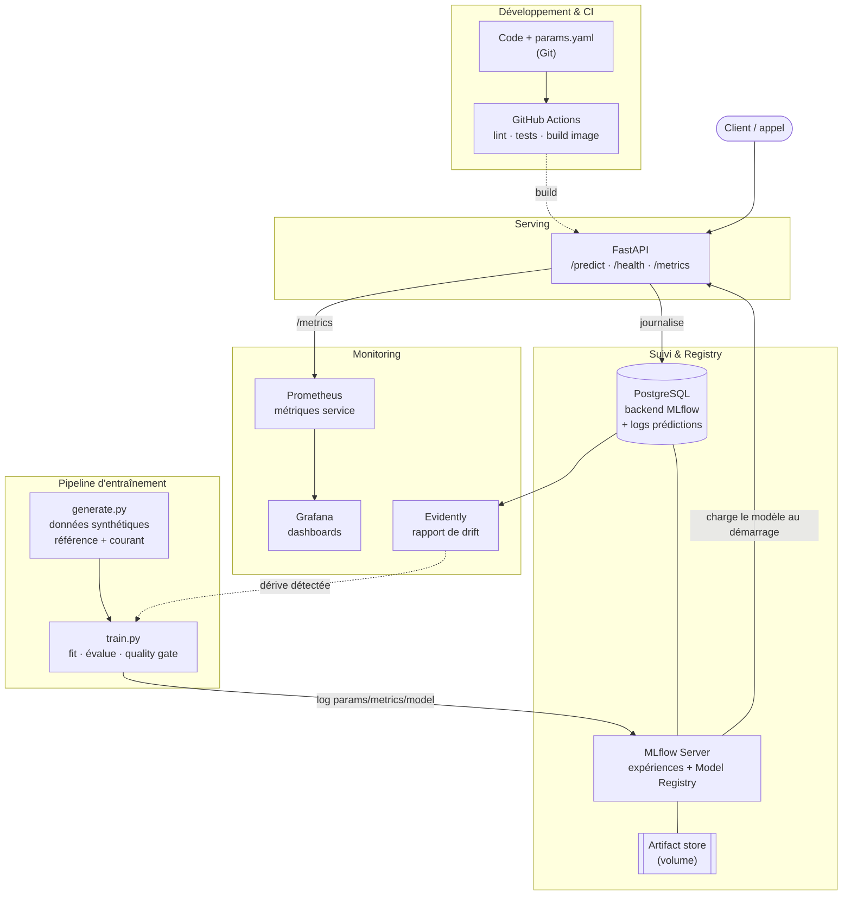

# Architecture — MLOps churn (local, open-source)

Ce document décrit l'architecture cible du projet : les composants, le flux de
bout en bout, les choix d'outils et leur justification, puis une feuille de
route. L'objectif est **pédagogique** : montrer *tous* les maillons d'une chaîne
MLOps avec une stack 100 % open-source tournant en local via Docker Compose.

## 1. Vue d'ensemble

Le cas d'usage est une **prédiction de churn** (classification binaire) sur des
données tabulaires synthétiques. Le choix du synthétique est délibéré : aucune
dépendance réseau, reproductibilité totale, et possibilité d'**injecter une
dérive** (`drift_shift`) pour démontrer le monitoring et le ré-entraînement.

Les trois boucles classiques du MLOps sont représentées :

1. **Boucle de données / entraînement** — générer → préparer → entraîner → évaluer → enregistrer.
2. **Boucle de service (inférence)** — charger le modèle depuis le registry → exposer une API → journaliser les prédictions.
3. **Boucle de supervision / feedback** — mesurer (service + drift) → décider → ré-entraîner.

## 2. Diagramme



## 3. Composants et choix d'outils

| Besoin MLOps | Outil retenu | Pourquoi ce choix |
|---|---|---|
| **Versionnement du code** | Git + `params.yaml` | Le code *et* les hyperparamètres sont versionnés ensemble → reproductibilité. |
| **Données** | `scikit-learn make_classification` | Reproductible, hors-ligne, et permet d'injecter une dérive pour la démo. |
| **Entraînement** | scikit-learn | Léger, standard, suffisant pour un cas tabulaire pédagogique. |
| **Suivi d'expériences** | **MLflow Tracking** | Standard de fait open-source, auto-hébergeable, UI incluse. |
| **Registry de modèles** | **MLflow Model Registry** | Versionne les modèles et gère les stages (Staging/Production). |
| **Backend de MLflow** | PostgreSQL | Backend store robuste (vs SQLite) ; sert aussi la base applicative. |
| **Serving** | **FastAPI + Uvicorn** | Rapide, typage Pydantic, OpenAPI auto, idéal pour un microservice d'inférence. |
| **Base applicative** | PostgreSQL (SQLAlchemy) | Journalise chaque prédiction → matière première du monitoring et du ré-entraînement. |
| **Métriques service** | **Prometheus + Grafana** | Latence, débit, taux d'erreur ; instrumentation FastAPI automatique. |
| **Drift de données** | **Evidently** | Rapports de dérive data/target prêts à l'emploi (HTML + JSON). |
| **Orchestration** | **Prefect** | Flux *détecter la dérive → ré-entraîner → promouvoir*, planifiable. |
| **Conteneurisation** | Docker + Docker Compose | Reproduit toute la stack en une commande, en local. |
| **CI** | GitHub Actions | Lint (ruff), tests (pytest), build d'image à chaque push/PR. |
| **Qualité** | ruff + pytest | Lint rapide et tests unitaires data/model/API. |

### Points de conception notables

- **Quality gate** : `train.py` refuse de promouvoir un modèle sous un seuil de
  ROC-AUC (`training.min_roc_auc`). Un mauvais modèle n'atteint jamais le registry.
- **Repli robuste** : si MLflow est injoignable, l'entraînement sauvegarde un
  modèle local (`joblib`) et l'API sait le charger — le système reste démarrable
  en dev et en CI sans toute l'infra.
- **Config centralisée** : un seul point d'entrée (`src/config.py`, Pydantic
  Settings + `params.yaml`), aucune valeur sensible en dur, `.env` pour les secrets.
- **Référence vs courant issus du même processus** : garantit qu'un modèle
  entraîné sur la baseline généralise aux données « de production » tant qu'il n'y
  a pas de dérive — ce qui rend la démo de drift crédible.

## 4. Flux de bout en bout

1. `make data` → génère `reference.csv` (baseline) et `current.csv` (production).
2. `make train` → entraîne sur le lot courant, évalue, passe le quality gate,
   logge dans MLflow et enregistre une nouvelle version du modèle.
3. `make promote` → compare la dernière version au champion (alias `production`)
   et promeut si elle est au moins aussi bonne (champion/challenger).
4. `make up` → démarre Postgres, MLflow, l'API, Prometheus et Grafana.
5. L'API charge le modèle `@production` (sinon la dernière version) et sert `/predict`.
6. Chaque prédiction est journalisée en base ; Prometheus scrape `/metrics`,
   Grafana les affiche sur un dashboard pré-provisionné.
7. `make drift` → compare référence vs courant (Evidently). `make retrain` →
   flux Prefect qui ré-entraîne et promeut **seulement si** une dérive est détectée.

## 5. Arborescence

```
mlops-churn/
├── docker-compose.yml          # orchestration locale de toute la stack
├── Makefile                    # raccourcis (data, train, drift, up, test…)
├── params.yaml                 # hyperparamètres versionnés
├── requirements.txt            # dépendances épinglées
├── .env.example                # gabarit de configuration
├── src/
│   ├── config.py               # config centralisée (Pydantic Settings + YAML)
│   ├── data/      generate.py · preprocess.py
│   ├── pipelines/ train.py · evaluate.py · promote.py · retrain_flow.py
│   ├── api/       main.py · schemas.py · model_loader.py
│   ├── db/        connexion.py · crud.py
│   └── monitoring/ drift.py
├── tests/                      # pytest : data · model · api · smoke
├── docker/                     # Dockerfiles + init DB MLflow
├── monitoring/                 # Prometheus + Grafana (datasource + dashboard)
├── run.ps1                     # équivalent Makefile pour Windows
└── .github/workflows/ci.yml    # CI : lint + tests + build
```

## 6. Feuille de route (prochaines étapes réalistes)

> Déjà implémentés : orchestration Prefect (ré-entraînement sur dérive),
> promotion champion/challenger (alias `production`), dashboard Grafana
> pré-provisionné.

- **Planification** : transformer le flux Prefect en *deployment* planifié
  (cron) ou déclenché par une alerte de monitoring, plutôt qu'à la demande.
- **Versionnement des données** : ajouter **DVC** pour versionner `data/` et les
  pipelines, et lier chaque run MLflow à une version de données.
- **Déploiement continu** : promotion automatique Staging→Production dans le
  registry si le modèle candidat bat le modèle en place (champion/challenger).
- **Monitoring avancé** : persister les métriques de drift dans Postgres et les
  afficher dans Grafana ; alerting (Alertmanager) sur dérive ou chute de perf.
- **Tests de charge & sécurité** : auth sur l'API, rate limiting, tests de
  contrat sur le schéma d'entrée.
- **Registry d'images** : publier l'image API sur un registre (GHCR) depuis la CI.
